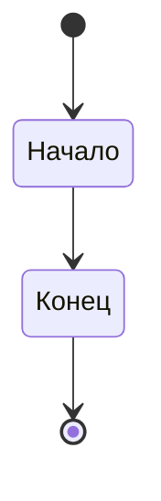
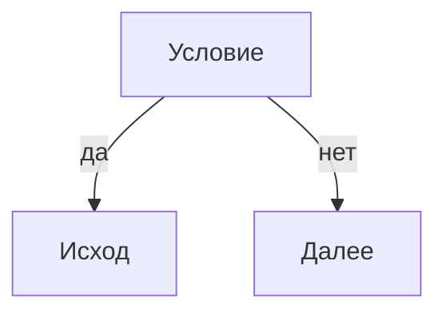

# {title} — флоу-документ

<!-- Витрина флоу. Истина — записи flow:<slug> и rule:<имя>-v<N>; таблица ниже —
     проекция таблицы решений записей. CLI-генерация витрины — в перспективе
     (план entity-catalog, задача 8). -->

**Актор:** <!-- бизнес-актор флоу целиком -->
**Запись флоу:** flow:<slug>

## Жизненный цикл

<!-- stateDiagram-v2: состояния из записи flow.states, старт → терминалы. -->

## Таблица решений

<!-- Истина — записи rule:<имя>-v<N>; строка таблицы = пример (given/when/then) правила.
     Колонка «Режим»: auto (шаг исполняет система) | ask-user (точка остановки: спросить
     человека; в ячейке допустима пометка «по умолчанию: <ветка>» на случай отказа/таймаута;
     пусто = auto). -->

| Приоритет | Rule ID | Условия | Исход | Код ошибки | Режим |
|---|---|---|---|---|---|
| 1 | rule:<имя>-v1 | <!-- given/when --> | <!-- исход --> | <!-- код или — --> | auto |

## Диаграмма исходов

<!-- mermaid flowchart — визуализация таблицы решений, не отдельная истина.
     Порядок ветвей = приоритеты строк таблицы. -->

## Lineage

<!-- Откуда данные каждого поля и кто ответственный. -->

| Поле | Откуда | Ответственный |
|---|---|---|
| <!-- поле --> | <!-- источник --> | <!-- роль/команда --> |
