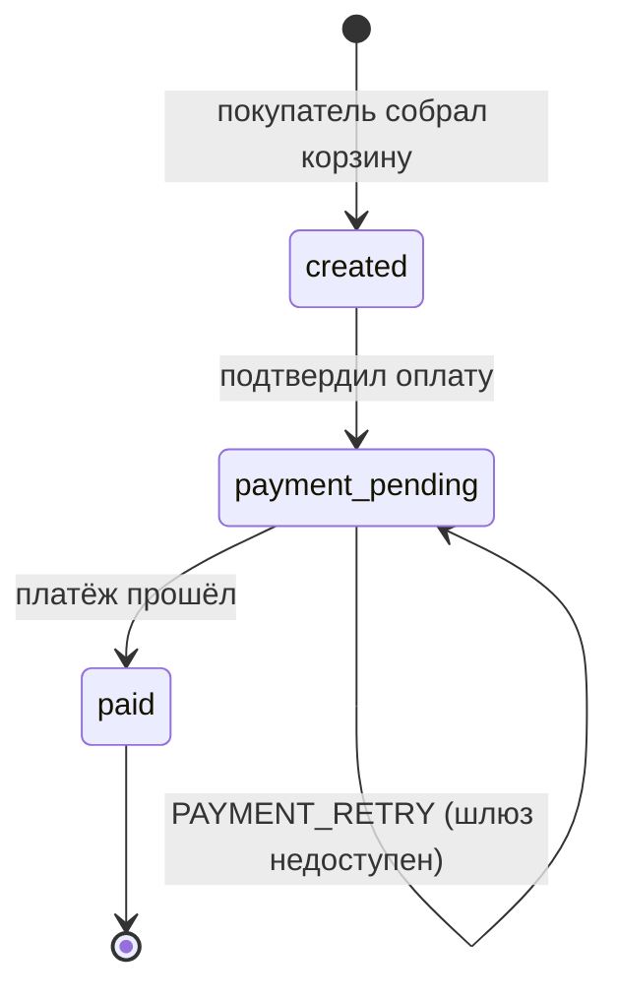
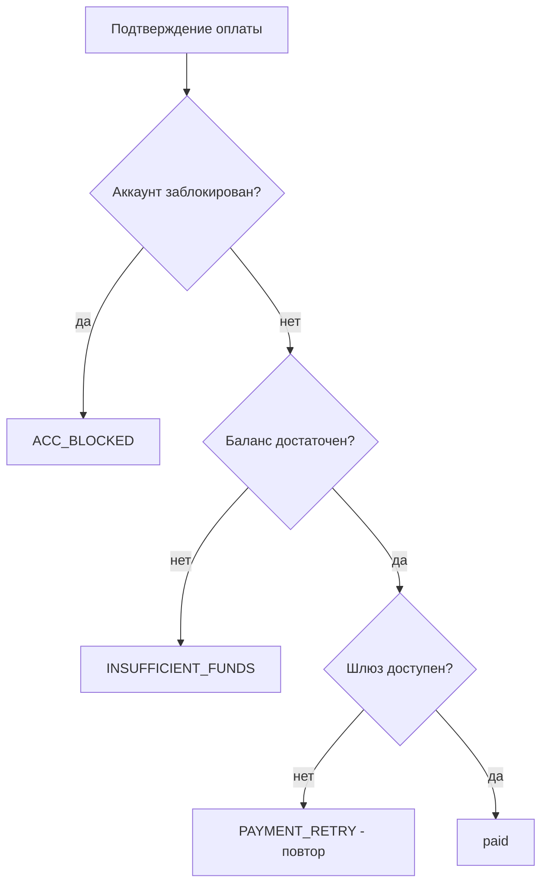

# Оформление заказа — флоу-документ

<!-- Витрина флоу. Истина — записи flow:order-placement и rule:account-blocked-v1 /
     rule:no-funds-v1 / rule:gateway-down-v1; таблица ниже — проекция их таблицы
     решений. CLI-генерация витрины — в перспективе (план entity-catalog, задача 8). -->

**Актор:** Покупатель
**Запись флоу:** flow:order-placement

## Жизненный цикл

Состояния из записи `flow:order-placement`:

## Таблица решений

<!-- Истина — записи rule:*-v1; строка таблицы = пример (given/when/then) правила.
     Режим: auto (шаг исполняет система) | ask-user (спросить человека; пометка
     «по умолчанию: <ветка>» на случай отказа/таймаута; пусто = auto). -->

| Приоритет | Rule ID | Условия | Исход | Код ошибки | Режим |
|---|---|---|---|---|---|
| 1 | rule:account-blocked-v1 | аккаунт покупателя заблокирован | заказ отклонён, оплаты нет | ACC_BLOCKED | auto |
| 2 | rule:no-funds-v1 | баланс меньше суммы заказа | отказ оплаты | INSUFFICIENT_FUNDS | auto |
| 3 | rule:gateway-down-v1 | платёжный шлюз недоступен | повтор платежа без списания | PAYMENT_RETRY | auto |
| — | — | проверки не сработали (happy path) | оплачено | — | auto |

## Диаграмма исходов

<!-- mermaid flowchart — визуализация таблицы решений, не отдельная истина.
     Порядок ветвей = приоритеты строк таблицы. -->

## Lineage

| Поле | Откуда | Ответственный |
|---|---|---|
| Баланс покупателя | сервис биллинга | команда биллинга |
| Цена заказа | сервис pricing | команда pricing |
| Статус платежа | платёжный шлюз | команда платежей |
| Статус аккаунта | сервис аккаунтов | команда аккаунтов |
