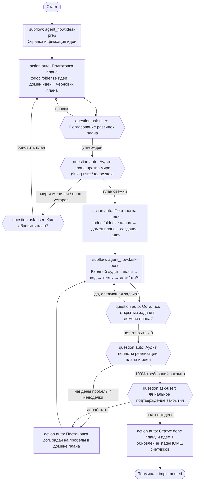

# Идея: сквозной флоу разработки на базе `agent_flow` и папок-доменов `folderize` (от идеи до петли аудита полноты)

- Тип: `idea`
- Создан: 2026-11-27
- Идентификатор: `doc:ideas/dev-lifecycle-flow.md`
- Статус: `captured` (идея зафиксирована, не перешла в план)

## Суть

Построить поверх универсального движка исполняемых агентных флоу ([`agent_flow`](agent-flows.md)) и механизма разворачивания сущностей в папки-домены ([`todoc folderize`](entity-to-folder.md)) **эталонный сквозной процесс разработки ПО (`agent_flow:dev-lifecycle`)**, состоящий из модульных подфлоу (`subflow`):
1. **`идея`** (со своим подфлоу огранки `agent_flow:idea-prep`) →
2. **`подготовка плана`** с превращением идеи в собственную **папку-домен** (`ideas/<slug>/`), чтобы CLI искал и работал с материалами идеи как с изолированным мини-проектом (`--within`) →
3. **`аудит плана` против изменившегося внешнего мира** перед нарезкой работ →
4. **`постановка задач`** с превращением плана в собственную **папку-домен** (`plan/<slug>/`), чтобы все задачи и артефакты этого плана жили и опрашивались как единый домен →
5. **цикл `реализация задачи`** (`agent_flow:task-exec`: входной аудит свежести задачи против мира → код → тестирование → документация/отчётность) →
6. **замкнутая петля `аудит полноты реализации плана`** после закрытия всех задач: если обнаружены недоделки или расхождения с исходной идеей — догенерация новых задач в домен плана и **возврат обратно в цикл реализации**; если закрыто `100%` требований — перевод плана и идеи в `done` и синхронизация живой документации (`state/`, `HOME.md`, счётчики).

## Проблема

1. **Контекст разрастающейся идеи и плана распыляется по общим папкам.** Когда вокруг идеи появляются заметки, ресёрчи, план и десяток задач, они разлетаются по плоским каталогам (`ideas/`, `plan/`, `tasks/`, `reports/`). Агент при поиске ловит шум соседних фич и не может работать с одной идеей или одним планом как с локальным изолированным проектом.
2. **Планы и задачи тухнут из-за изменений «внешнего мира» ещё до начала написания кода.** Между написанием плана и стартом конкретной задачи в `master` вливаются соседние PR, меняются сигнатуры функций или схемы типов, а предыдущая задача № 1 меняет модуль, на который опиралась задача № 3. Без обязательного узла входного аудита агент пишет код по устаревшим допущениям и ломает сборку.
3. **Закрытие всех чекбоксов задач не гарантирует, что план и идея реально выполнены целиком.** При декомпозиции часть краевых требований исходной идеи теряется, либо в ходе реализации задач остаются непокрытые стыки, несинхронизированная документация и забытые счётчики. В линейных пайплайнах последняя закрытая задача сразу ставит плану «галочку», оставляя скрытый технический долг.

## Принципы

1. **Самоподобные папки-домены на двух уровнях (`идея → домен`, `план → домен`).** Как только идея переходит к подготовке плана, она разворачивается через `todoc folderize` в контейнер домена; как только план переходит к постановке задач, он точно так же разворачивается в контейнер домена своих задач. Все поисковые и списочные команды CLI внутри шага скоупятся флагом `--within <папка-домена>`.
2. **Двойной барьер свежести против внешнего мира (`World-Drift Audit`).** Свежесть сверяется с реальным кодом `src/`, `git log` и `todoc stale` дважды: **перед нарезкой задач из плана** и **перед стартом каждой отдельной задачи**. Если расхождений нет (`auto`), агент проходит шаг молча за секунды; если мир изменился — поднимает стандартный квиз `ask-user` с вариантами корректировки.
3. **Запрет на закрытие плана без петли обратного аудита полноты (`Completeness Loop`).** Статус `done` недостижим напрямую из списка задач: между «все текущие задачи закрыты» и «план/идея реализованы» стоит обязательный узел сверки факта с исходной идеей и планом, имеющий обратное ребро в цикл постановки и исполнения доп. задач.
4. **Модульность через `subflow`.** Сквозной `agent_flow:dev-lifecycle` не является монолитом: подфлоу `agent_flow:idea-prep`, `agent_flow:plan-audit` и `agent_flow:task-exec` могут вызываться как самостоятельно (например, для одиночной задачи без большого плана), так и внутри сквозного маршрута.

## Предложение

### 1. Модульная карта графа `agent_flow:dev-lifecycle`

### 2. Детальная механика каждого этапа и работа с папками-доменами

#### Этап 1. Подготовка идеи (`subflow: agent_flow:idea-prep`)
- Проверка дубликатов и смежных документов через `todoc docs search --type idea` и `--within state`.
- Короткий квиз `ask-user` (по 1–2 развилки с вариантом `[Рекомендуется]`) только по нерешённым архитектурным вопросам.
- Создание файла идеи по шаблону `todoc docs new --type idea`, прямое наполнение разделов и финализация через `todoc sync <path>` ([`direct-edit-and-git-sync`](direct-edit-and-git-sync.md)).

#### Этап 2. Подготовка плана и создание домена идеи (`folderize`)
- Идея разворачивается одной транзакцией **`todoc folderize --id doc:ideas/<slug>.md --subdirs plan,.research --apply`** (см. [`entity-to-folder`](entity-to-folder.md)):
  - создаётся папка-домен `ideas/<slug>/` с паспортом `.config.json` и корневым файлом `ideas/<slug>/<slug>.md`, все входящие и исходящие ссылки пересчитываются автоматически;
  - теперь любой поиск `todoc docs search --within ideas/<slug>` и дерево `todoc docs tree --within ideas/<slug> --meta` работают с этой идеей и её материалами как с отдельным сфокусированным проектом.
- Создаётся документ плана (с якорями `derived_from` на идею и затрагиваемые модули `src/`), согласуется с пользователем на узле `ask-user`.

#### Этап 3. Аудит плана против внешнего мира (`auto` → `ask-user` при дрейфе)
- Перед тем как резать задачи, узел `question (mode: auto)` проверяет:
  1) `todoc stale --root KB` по якорям плана;
  2) `git log` и реальное состояние файлов `src/`, упомянутых в файловой карте плана;
  3) отсутствие конфликтов с соседними активными планами (`todoc plan portfolio`, см. [`wave-planning-cli-helpers`](wave-planning-cli-helpers.md)).
- Если всё актуально — **молча без остановки** переходит к постановке задач. Если внешний мир ушёл вперёд или часть плана устарела — поднимает квиз `ask-user`: *«1. Точечно актуализировать затронутые секции плана [Рекомендуется] / 2. Пересобрать план с учётом новых изменений / 3. Продолжить без правок»*.

#### Этап 4. Постановка задач и создание домена плана (`folderize`)
- Утверждённый и свежий план разворачивается через **`todoc folderize`** в собственную папку-домен плана (например, `plan/<plan-slug>/` или `ideas/<slug>/plan/<plan-slug>/` с подпапками `tasks,reports` и своим `.config.json`).
- Внутри `tasks/` этого домена создаются записи задач (`entity_type: task` со связью `implements` на план). За счёт `--within <папка-плана>` агент выбирает, фильтрует и агрегирует задачи **строго этого плана**, не цепляя бэклог других планов.

#### Этап 5. Подфлоу реализации одной задачи (`agent_flow:task-exec`)
Для каждой открытой задачи из домена плана прогоняется чёткий четырёхтактный цикл:
1. **Входной аудит задачи (`auto`, при конфликте → `ask-user`):** не изменились ли целевые файлы и контракты после выполнения предыдущих задач или свежих коммитов в репозитории? Если предыдущая задача поменяла интерфейс — задача корректируется до написания кода.
2. **Реализация (`action`, `props.skill: "test-driven-development"`):** написание тестов и кода строго в границах задачи.
3. **Тестирование и верификация (`question: auto`, `props.check`):** прогон `pytest`, ветвевого покрытия `100%`, `todoc validate --all` и `linkcheck`. При падении — ребро цикла возвращает на доработку, а поле `guidance` (`P15`) подсвечивает точный рецепт починки.
4. **Документация и отчётность по задаче (`action`):** обновление затронутых контрактов/спек, формирование записи в отчёте задачи (`reports/` внутри домена плана или секция хода работ), `todoc sync`, перевод статуса задачи в `done`.

#### Этап 6. Замкнутая петля аудита полноты плана и финальное закрытие
Когда в домене плана `open tasks == 0`:
1. **Узел `completeness_audit` (`auto`):** агент вычитывает исходную идею (все пункты «Суть» и «Предложение») и критерии успеха плана и построчно сверяет их с реально написанным кодом, тестами и документацией:
   - проверяет, нет ли забытых подпунктов, заглушек `TODO/TBD`, непокрытых краевых веток, необновлённых промптов/скилов или протухших якорей `stale`.
2. **Ветка «Обнаружены пробелы»:** агент **не закрывает план**, а создаёт недостающие доп. задачи `task:*` прямо в папку-домен плана и по обратному ребру возвращается в **Этап 5 (`agent_flow:task-exec`)**. Петля крутится до тех пор, пока аудит полноты не даст `0` расхождений.
3. **Ветка «Полнота 100%»:**
   - узел `ask-user` показывает пользователю короткую сводку готовности (4 буллета без воды) и запрашивает подтверждение закрытия;
   - после подтверждения переводит план и исходную идею в статус `done` (`todoc docs status --set done`), обновляет актуальную картину мира в `state/` ([`type-naming-and-state-dir`](type-naming-and-state-dir.md)), оглавление `HOME.md` и фактические счётчики в `README.md`.

## План внедрения

1. **Зависимости (базовые кирпичики):** реализация [`todoc folderize` + `--within` для записей](entity-to-folder.md), короткой команды финализации [`todoc sync`](direct-edit-and-git-sync.md) и движка [`agent_flow` + `todoc flows step`](agent-flows.md).
2. **Сборка пакета из 3 модульных записей `agent_flow`:**
   - `agent_flow:idea-prep` (подготовка идеи);
   - `agent_flow:task-exec` (аудит задачи → реализация → тесты → доки/отчёт);
   - `agent_flow:dev-lifecycle` (главный граф с двумя `folderize`, аудитом плана и петлёй аудита полноты).
3. **Привязка к типам и проверка на реальной фиче:** прописать `agent_flow:dev-lifecycle` и `agent_flow:idea-prep` в поле `flows` типов `idea` и `plan`, сгенерировать их Markdown-витрины через `todoc flows render --write` и провести по этому флоу первую реальную фичу движка от сырой идеи до `done`.

## Открытые вопросы

- **Где располагать папку-домен плана — внутри папки-домена идеи (`ideas/<idea>/plan/<plan>/`) или в корневой `plan/<plan>/` со связью `derived_from`?** Оба варианта поддерживаются `todoc folderize` и маской `**/plan` (`dir_type: plan`): если у одной идеи ровно один план — вложенность `ideas/<idea>/plan/<plan>/` собирает вообще весь жизненный цикл фичи в одно дерево; если один мастер-план объединяет сразу 4 разные идеи (как волновой план) — удобнее развернуть его в `plan/<master-plan>/` со ссылками на идеи. Этот выбор логично сделать автоматическим правилом на Этапе 2 (`1 идея → внутри домена идеи`, `N идей → в plan/<slug>/`).
- **Компактные микро-задачи на 5 минут (Fast-Track ветка):** стоит ли на старте `agent_flow:dev-lifecycle` предусмотреть быструю развилку масштаба (`question`: *«Тривиальный хотфикс в 1 файл без плана vs полноценная фича»*), чтобы однострочный фикс сразу шёл в `subflow: agent_flow:task-exec` без создания двух папок-доменов? Да — это избавит мелкие правки от лишней церемонии.

## Связанные документы

- [Идея: агентные флоу (`agent_flow`) — исполняемые деревья решений, квиз из рёбер и скил `flow-runner`](agent-flows.md)
- [Идея: `todoc folderize` — преобразование любой сущности в папку-домен с `.config.json` и `--within`](entity-to-folder.md)
- [Идея: прямое редактирование файлов и короткая команда финализации `todoc sync <path>`](direct-edit-and-git-sync.md)
- [Идея: стандарт именования типов и папка `state/` как реальная картина мира (`AS-IS`)](type-naming-and-state-dir.md)
- [Идея: CLI-команды волнового планирования (`todoc stale anchor/reanchor` и `todoc plan portfolio`)](wave-planning-cli-helpers.md)
- [Идея: самодокументируемое поле `guidance` для моделей (`P15`)](cli-model-guidance-and-hint-catalog.md)
- [Конституция `todoc`](../plan/constitution.md)

## Связь с выпущенным CLI

Обзор планов и идей, навигация по связям доступны. Автоматизированный флоу разработки сохраняет отдельную приёмку.
[Результаты выпуска](../notes/unified-cli-release.md).
