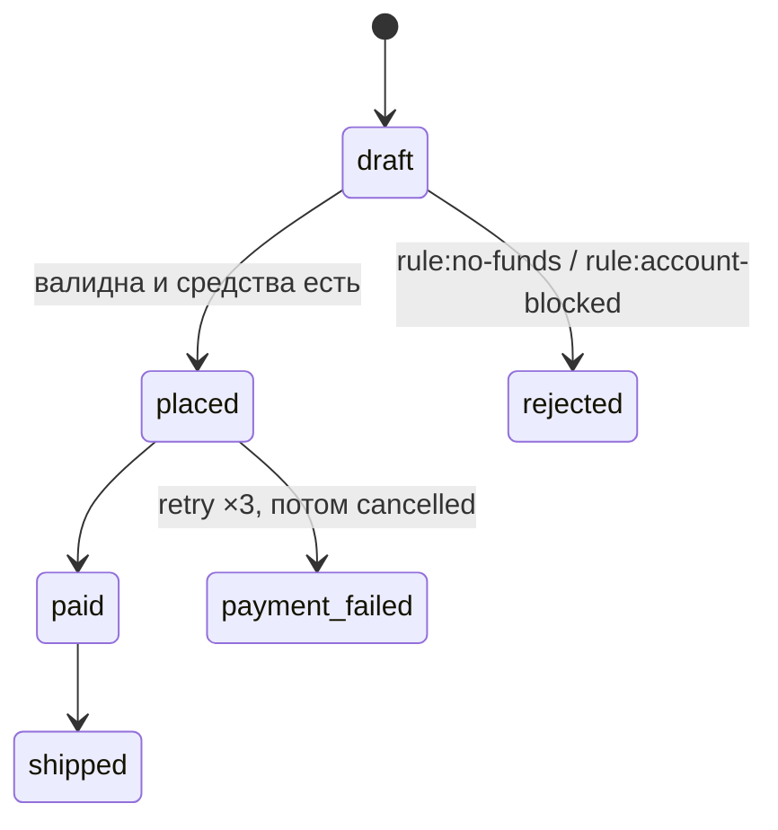
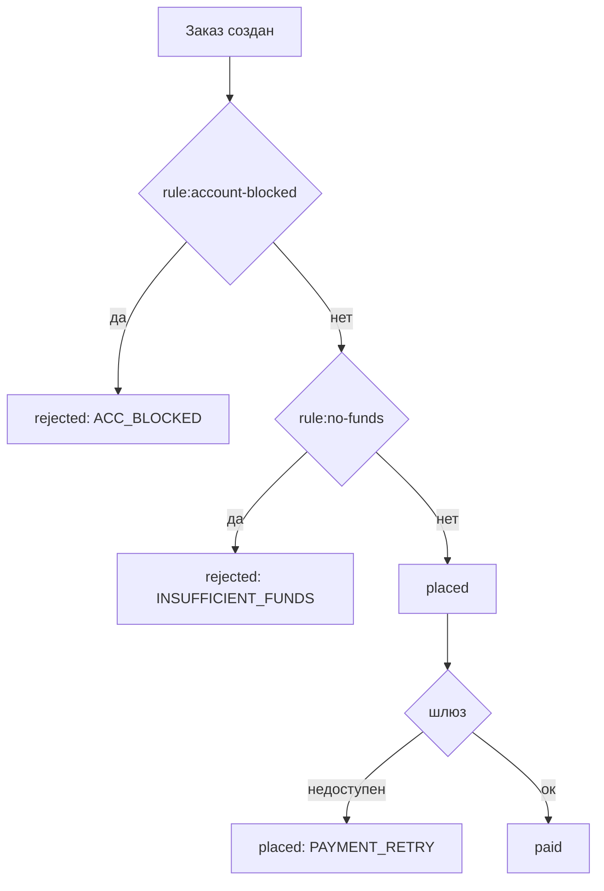

# Идея: система документирования кодовой базы через агента

**Статус:** идея, не перешла в план. Описана до состояния, из которого можно реализовывать
рабочую систему; включает аудит-обзор OpenSpec и Spec Kit (25.11.2026), практики оформления
спек и дизайн импорта/экспорта. Реализация начнётся после scope gate (см. «План внедрения»).

## Суть

Автоматизировать ведение документации состояния проекта: агент собирает по веткам задач
дифы из git и тексты задач из Jira API, превращает их в черновики типизированных документов
и записей todoc (review-first), а релизные и процессные правила фиксируются как связи
между записями. История бизнес-логики восстанавливается из графа версий, а не из журналов.
Спека-артефакты (предложение → сценарии → задачи → отчёт) образуют жизненный цикл в духе
OpenSpec/Spec Kit, но хранятся в todoc и связываются с флоу, правилами и релизами одним
типизированным графом; предусмотрен импорт/экспорт OpenSpec в обе стороны.

## Проблема

Контекст конкретный: большой продуктовый репозиторий, команды работают через Jira.
Ветка задачи именуется `features/#1301`, релизная — `releases/5.7.2`; релизная ветка
живёт долго, **прошлый релиз мержится в следующий** (merge-forward), **параллельная работа
над двумя релизами — норма** (5.7.2 и 5.8.0 существуют одновременно). Кодовая база
несёт бизнес-логику: «если на счету ноль — заказ не провести», «платёж ретраится три раза,
потом заказ отменяется» — и у каждого флоу есть поток данных (что откуда берётся: баланс
из биллинга, цена из pricing, статус локально).

Проблемы в этой конкретной конфигурации:

1. **Агент слеп к процессу.** Севши в репо, агент не знает ни что `features/#1301` — это
   задача Jira 1301, ни что задача о ней лежит в другом сервисе, ни как живут релизы:
   что `releases/5.7.1` мержится в `releases/5.7.2`, что два релиза ведутся параллельно,
   что значит «успешный merge-forward». Каждое пояснение — разовое, из головы человека.
2. **Бизнес-флоу не восстановим из кода.** Все возможные исходы флоу оформления заказа
   (rejected/placed/paid/shipped/…) рассыпаны по условиям `if` в разных сервисах; агент
   не может ответить «что будет с заказом при балансе 0? при падении платёжного шлюза?»
   не вычитав пол-кодовой базы — и всё равно не уверен, что собрал все ветки.
3. **Правила не версионируются как знания.** «Нет денег → нет заказа» поменялось в задаче
   #1301, но у агента нет способа узнать: в какой задаче правило появилось, как менялось,
   какой вариант действовал на релизе 5.7.1, какой баг у него был.
4. **Параллельные релизы = скрытые конфликты.** Два релиза трогают одну бизнес-логику
   независимо; никто не видит пересечения до конфликтного мерджа, потому что «затронутые
   флоу» нигде не сопоставляются.
5. **Документация состояния гниёт.** Никто не обновляет её при каждом PR; ручная дисциплина
   не работает на большой кодовой базе.
6. **Знания размазаны.** Задачи — в Jira, изменения — в git, смысл — в головах. Связка
   «задача → правка → затронутое правило» не восстанавливается ни одним инструментом.
7. **Задачи нечитаемы для людей.** История «что сделано и почему» рассыпана по тикетам и
   коммитам; человекочитаемых отчётов по старым и новым задачам никто не строит.

## Принципы

1. **Связки, не копии.** Jira и git — источники истины. В todoc храним только то, чего в них
   нет (бизнес-смысл, флоу, правила) и связи (`origin.task` — поле, не ребро: задачи Jira
   не являются записями датасета и не могут быть целями рёбер).
2. **Review-first.** Агент готовит черновики (`--preview`), человек применяет (`--apply`).
   Автозапись без ревью запрещена — это и защита от галлюцинаций, и принцип P6 конституции.
3. **Append-only версии.** Записи create-only. Изменилось правило — новая запись
   `rule:<имя>-v<N+1>` с ребром `supersedes` на предыдущую. Старая не редактируется и
   не удаляется; актуальная версия — та, на которую нет входящих `supersedes`.
4. **CLI-first для агента.** Файлы — для людей и переносимости; агент отвечает на вопросы
   через команды todoc (`records list --relation`, `relations graph`), потому что граф
   связей — производный и существует только в индексе.
5. **Флоу = четыре артефакта, истина одна.** State machine статусов (навигация),
   **таблица решений — источник истины** (условия → исход, каждая строка — проверяемый
   кейс), flowchart — визуализация таблицы, lineage данных («откуда поле»).
   Дерево решений — только проекция, не отдельная истина.
6. **Правила = тесты.** Строки таблицы решений читаются параметризованными тестами и
   прогоняются через код: документ разошёлся с кодом — CI красный. Документация без
   принуждения не работает (см. [Конституция](../plan/constitution.md), P6).
7. **Bounded context.** Любой ответ агента — через `docs search/read` с лимитами и бюджетом,
   не через вываливание всего датасета в контекст.
8. **Офлайн-ядро.** Сборка черновиков детерминирована; Jira подключается по требованию
   (MCP или REST + токен), без скрытой сети.
9. **Спека — это данные, не проза.** Требования в формате SHALL + сценарии WHEN/THEN,
   дельты ADDED/MODIFIED/REMOVED, явные статусы жизненного цикла (proposal → applied →
   archived) — как в OpenSpec; тогда спеки конвертируются, валидируются и связываются
   с записями, а не лежат мёртвым текстом.

## Предложение

### Терминология

| Термин | Значение |
|---|---|
| **Спека (capability spec)** | требования к одной способности системы + сценарии поведения; «живёт» между изменениями |
| **Change (изменение)** | предложение изменений: зачем, что меняется, какие требования ADDED/MODIFIED/REMOVED, задачи |
| **Task snapshot** | снимок задачи Jira на момент захвата (текст, статус, URL); живая истина — в Jira |
| **Task report** | человекочитаемый отчёт по задаче/набору задач: что, зачем, как проверялось |
| **Rule version** | версия бизнес-правила `rule:<имя>-v<N>`; цепочка `supersedes` = история правила |
| **Collector** | очередь сбора: детерминированный сбор фактов (git/Jira) → черновики для ревью |

### Очередь сбора (collector)

Единая очередь заданий «что задокументировать», из которой агент берёт работу пошагово:

| Шаг | Вход | Обработка | Выход |
|---|---|---|---|
| 1. Ветки | `git branch --list 'features/*'` | diff ветки против базы: `git diff base...HEAD` | список затронутых файлов и модулей задачи `#N` |
| 2. Релизы | мержи `releases/X → Y` | лог мержей + совпадение `features/#N` | список задач релиза, порядок merge-forward |
| 3. Jira | ID задач из веток/мержей | fetch через MCP/REST: заголовок, описание, статус, тип | текст задачи (снимок) |
| 4. Классификация | шаги 1–3 | агент: какие флоу/правила/модули затронуты | черновик `change`-записи: proposal + дельты требований |
| 5. Черновики | задания | `docs new` / `records create --preview` | файлы-черновики, план записи без применения |
| 6. Ревью | дифф черновиков | человек читает PR | `--apply`, коммит в том же PR |
| 7. Релиз-запись | merge-forward релиза | сводка задач + затронутых флоу | запись `release:X.Y.Z` со связями |
| 8. Отчёты | шаги 3–7 | агент собирает `task-report` | человекочитаемый отчёт для стейкхолдеров |

Очередь материализуется как файл заданий (JSON) или записи в `records/queue/` —
важно, чтобы шаги были возобновляемыми (черновик не теряется при обрыве) и наблюдаемыми
(по каждому заданию видно статус: собрано → черновик → применено). Дедуп: коллектор перед
созданием ищет существующий `change` по `origin.task` — повторный прогон обновляет
черновик, а не плодит дубли.

### Связывание задач с правками

- `origin.task` — обязательное поле всех изменяемых записей; берётся из имени ветки
  `features/#1301` автоматически, человеком не набирается.
- Conventional commits с номером задачи: `feat(#1301): заказ отклоняется при нулевом балансе`
  — тогда `git log` становится запрашиваемым знанием без дополнительных структур.
- Ребро `affects` от задачи-снимка к флоу/модулю, `fixes` от релиза к инциденту,
  `supersedes` между версиями правил, `implements` от change-записи к флоу/правилу.
- Инцидент (разрешённый баг с бизнес-семантикой) связывается ребром `contradicts`
  с конкретной версией правила, которую он опроверг, — так баг становится частью истории правила.
- Полная история по правиле: change `#1301` (`implements` → `rule:no-funds`) → инцидент
  (`contradicts` → `rule:no-funds-v1`) → `rule:no-funds-v2` (`supersedes` → v1) →
  релиз (`fixes` → инцидент). Всё восстанавливается `relations graph`.

### Флоу-документ: эталон (оформление заказа)

Каждый флоу описывается **четырьмя артефактами в одном документе** (`doc_type: flow-doc`).
Истина — таблица решений (б); остальные — проекции: state machine (а) для навигации по
статусам, flowchart (в) — визуализация таблицы для чтения, lineage (г) — поток данных.
Пример — оформление заказа, тот самый случай «нет денег → нет заказа».

**(а) Жизненный цикл сущности — state machine по статусам заказа:**



**(б) Таблица решений — источник истины, все исходы «условия → исход».** Каждая строка —
проверяемый кейс: она попадает в `examples` записи правила и в fixture-тесты (фаза 4).
Приоритет строк = порядок проверки условий (P1 сверху):

| Приоритет | Rule ID | Счёт активен | Баланс ≥ сумма | Шлюз доступен | Исход | Код ошибки |
|---|---|---|---|---|---|---|
| P1 | `rule:account-blocked` | нет | — | — | отказ, заказ → rejected | ACC_BLOCKED |
| P2 | `rule:no-funds` | да | нет | — | отказ, заказ → rejected | INSUFFICIENT_FUNDS |
| P3 | `rule:gateway-down` | да | да | нет | заказ → placed, платёж в retry | PAYMENT_RETRY |
| — | happy path | да | да | да | оплата, заказ → paid | — |

**(в) Диаграмма исходов — Mermaid flowchart, визуализация таблицы (б), не отдельная
истина.** При изменении (б) обновляется и она; агенту читается «деревом» без взрыва ветвей:



**(г) Lineage — флоу на уровне данных, «что откуда берётся»:**

| Поле | Откуда | Ответственный |
|---|---|---|
| `order.amount` | pricing-service `POST /v1/price` | команда pricing |
| `account.balance` | billing-db `accounts.balance` (реплика, лаг ≤ 1 c) | команда billing |
| `order.status` | локально, `orders.status` | эта команда |

Связи документа: записи `rule:*` из таблицы держат ребро `belongs_to` на
`flow:order-placement`; задача `#N`, изменившая флоу, — ребро `affects` от своей
change-записи. Валидатор проверяет: секции на месте (`required_sections`), каждое
`rule:` из таблицы существует как запись (нет `relation.dangling_target`),
примеры строк — исполняемые (fixture-тесты, фаза 4).

### Какие типы добавить

Сущности (entity_types, JSON Schema + required_fields + path_template):

| type_id | Назначение | Обязательные поля | path_template |
|---|---|---|---|
| `task-snapshot` | снимок задачи Jira на момент захвата | `record_id`, `entity_type`, `jira_key`, `title`, `status_at_fetch`, `url`, `fetched_at`, `origin` | `records/tasks/{slug}.json` |
| `release` | релиз: версия, дата, задачи, бизнес-сводка | `record_id`, `entity_type`, `version`, `date`, `jira`, `summary`, `origin` | `records/releases/{slug}.json` |
| `flow` | бизнес-флоу: участники, состояния, исходы | `record_id`, `entity_type`, `title`, `actor`, `states`, `outcomes`, `origin` | `records/flows/{slug}.json` |
| `rule` | бизнес-правило с примерами-тестами | `record_id`, `entity_type`, `statement`, `examples`, `origin`, `status` | `records/rules/{slug}.json` |
| `incident` | разрешённый баг: симптом, причина, урок | `record_id`, `entity_type`, `title`, `symptom`, `root_cause`, `lesson`, `origin` | `records/incidents/{slug}.json` |
| `change` | предложение изменений (жизненный цикл OpenSpec): `proposal → applied → archived`, затронутые требования, ссылки | `record_id`, `entity_type`, `title`, `state`, `requirements_delta`, `origin` | `records/changes/{slug}.json` |

Дельта требований (`requirements_delta`) повторяет маркеры OpenSpec — списки
`added` / `modified` / `removed` с формулировками SHALL, поэтому change-запись
конвертируется в `proposal.md` и обратно без потери структуры (см. «Импорт/экспорт»).

Типы документов (doc_types): `idea` (введён), `flow-doc` — эталон из раздела выше:
`required_sections` («Жизненный цикл», «Таблица решений», «Диаграмма исходов», «Lineage»),
таблица решений = истина, flowchart = визуализация; `release-note` (формат релизной
сводки), `task-report` (человекочитаемый отчёт по задачам — ниже отдельный раздел),
`spec-doc` (capability-спека в нотации OpenSpec: требования SHALL + сценарии).

Типы папок (dir_types): `idea` (введён), `flows` (флоу-документы), `reports` (task-report),
`specs` (capability-спеки).

Типы связей (relation_types): `belongs_to` (правило → флоу), `affects` (задача/релиз → флоу),
`fixes` (релиз → инцидент), `contradicts` (инцидент → версия правила), `implements`
(change → флоу/правило/спека). Уже есть и переиспользуются: `supersedes`, `derived_from`,
`documents`, `references`.

Ограничения схемы: `record_id` правила — `^rule:[a-z0-9-]+-v[0-9]+$` (нейминг версий
enforced схемой); `change.state` — enum `proposed | applied | archived`; `status` правила —
`active | superseded | rejected` (истина — в рёбрах, статус — аннотация для человека).

### Task report: человекочитаемые отчёты из задач

Отдельный doc_type для стейкхолдеров и будущих членов команды: «что сделано, зачем,
как проверялось» — по старым и новым задачам, собирается агентом из уже имеющихся данных.

Источники отчёта: `task-snapshot` (зачем — текст задачи), git-диф ветки (что изменилось —
файлы и модули), записи `change`/`rule`/`incident` (как это легло в бизнес-логику),
`release` (в каком релизе поехало). Ничего не набирается руками.

Формат `task-report` (`reports/YYYY-MM-<slug>.md`), `required_sections`:

```markdown
## Задача            ← jira_key, title, ссылка, статус на момент захвата
## Зачем             ← из описания задачи: проблема и ожидаемый эффект
## Что изменилось    ← из git-дифа: модули, флоу, правила; human-readable, не патч
## Как проверялось   ← из примеров правил/тестов: given/then, сценарии
## Риски и уроки     ← из инцидентов и открытых вопросов
```

Промпт `create` для `task-report` (эталон, детализация как у `idea`):

```markdown
# Создание: `task-report`
1. Источники — только существующие данные; ничего не выдумывай:
   todoc records read --root KB --id task:<N>            # снимок задачи
   git log --oneline features/#<N> ^main                 # коммиты задачи
   todoc records list --root KB --relation affects=task:<N>   # затронутое
2. Черновик: todoc docs new --root KB --type task-report --title "..." --dir reports
3. Раздел «Что изменилось» — по модулям и флоу, не построчный дифф.
4. Каждый факт — со ссылкой на источник (запись/документ/коммит).
5. todoc validate --root KB --all    # 0 диагностик
```

### Практики оформления спек: что взято у Spec Kit и OpenSpec

Обзор инструментов от 25.11.2026: Spec Kit (~132K stars, MIT, Python/uv, GitHub) и
OpenSpec (~66.5K stars, MIT, TypeScript/npm, Fission AI) — два главных SDD-фреймворка;
сравнения: codemyspec.com/blog/openspec-vs-spec-kit, aicodingpatterns.com (OpenSpec vs
Spec Kit vs BMAD), andrew.ooo (OpenSpec Review). Общие практики, которые берём:

1. **Требования в SHALL + сценарии WHEN/THEN** (нотация OpenSpec): требование — атомарное
   утверждение с ключевым словом SHALL; под ним сценарии вида
   `#### Scenario: N` со строками `- **WHEN** …` / `- **THEN** …`. Ровно это уже
   хранится в `examples` наших правил (given/then) — форматы взаимно конвертируемы.
2. **Дельты требований**: изменение выражается маркерами `## ADDED Requirements`,
   `## MODIFIED Requirements`, `## REMOVED Requirements` относительно текущей спеки —
   в todoc это `requirements_delta` записи `change`.
3. **Жизненный цикл с архивом**: у OpenSpec изменение — папка `proposal.md + specs/ +
   design.md + tasks.md`; после внедрения `openspec archive` переносит её в
   `changes/archive/YYYY-MM-DD-slug/` и **обновляет основные спеки**. Аналог в нашем
   процессе: `change.state = archived` + рёбра к релизу; основные спеки (`spec-doc`)
   обновляются применённым change.
4. **Гейты качества**: у Spec Kit это `/speckit.clarify` (до 5 точных вопросов по
   недоопределённым местам, ответы вшиваются обратно в спеку), `/speckit.checklist`
   («unit-тесты для требований» — чек-лист полноты/однозначности, reviewer-owned),
   `/speckit.analyze` (проверка согласованности артефактов перед имплементацией).
   У нас: раздел «Открытые вопросы» (обязателен до реализации), фаза 0=scope gate,
   fixture-тесты = исполняемый аналог checklist.
5. **User stories с приоритетами**: спека Spec Kit строится из историй P1/P2/P3,
   таски группируются по историям (фазы Setup → Foundational → по истории → Polish).
   Берём для крупных флоу: исходы флоу ранжируются, реализация режется по приоритету.
6. **Constitution**: принципы проекта, с которыми сверяется каждая спека — у нас уже
   есть ([Конституция](../plan/constitution.md)); в промптах типов добавляем шаг
   «сверь предложение с конституцией, при конфликте — остановись».
7. **Independence и no-stakes исследование**: `/openspec-explore` — «обдумывание без
   обязательств» до proposal; в todoc это этап до создания change-записи: агент
   собирает варианты в черновик идеи, а не сразу в спеку.

### Импорт/экспорт: OpenSpec ↔ todoc

Оба формата — plain Markdown, обмен реален без конвертации «в никуда».

**Экспорт todoc → OpenSpec** (для команды, работающей через OpenSpec):

| todoc | OpenSpec |
|---|---|
| запись `change` (`requirements_delta`) | папка `openspec/changes/<slug>/` |
| — | `proposal.md` = Зачем/Что меняется из записи + ссылки |
| списки `added/modified/removed` | `specs/<capability>/spec.md` с `## ADDED/MODIFIED/REMOVED Requirements` |
| `examples` правил (given/then) | `#### Scenario:` + `- **WHEN**/- **THEN**` |
| связь `origin.task` | строка в proposal (Task: #N) |
| `state: archived` + релиз | факт архивации (`openspec archive`) |

Экспортёр (скрипт или агент по промпту): читает записи через CLI (`records read`), пишет
Markdown-папки; front matter todoc (id/doc_type) добавляется только в наши копии и не
мешает OpenSpec — у него нет требований к front matter.

**Импорт OpenSpec → todoc**: парсер читает `openspec/changes/<slug>/` → создаёт черновики
`change` (+ `task-snapshot`, если в proposal есть Task: #N) через `records create --preview`;
`### Requirement:` → элементы дельты, `#### Scenario:` → `examples`-строки. Спеки из
`openspec/specs/<capability>/spec.md` импортируются как `spec-doc` документы с рёбрами
`documents`/`derived_from` на затронутые флоу.

**Spec Kit → todoc**: `spec.md` (user stories + FR + success criteria) → `spec-doc` +
запись `change`; `tasks.md` (фазы) → сохраняется как документ-приложение; `constitution.md`
сверяется с нашей конституцией вручную (не сливать автоматически). Обратный экспорт —
те же артефакты из записей change/flow/rule.

Ограничения: ID-маппинг `record_id ↔ slug папки` фиксируется в `origin.external_id`;
нотация SHALL — конвенция, enforced только нашими required_sections/схемами; `openspec
validate` проверяет структуру своих папок, а не бизнес-связи — связность даёт только todoc.

### Обзор OpenSpec (для командных сценариев)

Философия: fluid not rigid, iterative not waterfall, brownfield-first. Навыки (skills):
профиль core — `/openspec-explore` (исследование без обязательств), `/openspec-propose`
(создание change: proposal + specs + design + tasks), `/openspec-apply-change`
(исполнение задач), `/openspec-archive-change` (архивация + обновление спек);
расширенный профиль (`openspec config profile`): `openspec-new-change`,
`openspec-continue-change`, `openspec-ff-change`, `openspec-verify-change`,
`openspec-bulk-archive-change`, `openspec-onboard`. Навыки ставятся в `.agents/skills/`
(или глобально `~/.agents/skills/`), 30+ инструментов.

CLI (полный список, openspec.dev/docs/cli): setup — `init` (`--tools`, `--scope
project|global`), `update`, `config`; чтение — `list [--specs]`, `show`, `view` (дашборд),
`validate` (структурные проверки), `archive`; workflow — `new`, `status`, `instructions`,
`templates`, `schemas`, `schema`; multi-repo (beta) — `store` (отдельный репозиторий спек
на команду), `doctor`, `context`, `workset`; утилиты — `version`, `install`, `feedback`,
`completion`. Ключевая идея для нас: **stores** — общее хранилище спек в отдельном репо,
читаемое всеми кодовыми репо и агентами.

### Обзор Spec Kit (для процессных сценариев)

Три независимых процесса (не фазы): SDD (в ядре), bug fixing и idea assessment
(bundle-расширения). Ядро SDD — 9 команд: `/speckit.constitution` (принципы проекта),
`/speckit.specify` (что и зачем: user stories + требования), `/speckit.clarify` (до 5
вопросов по неоднозначностям), `/speckit.plan` (тех-план: стек и архитектура),
`/speckit.checklist` (чек-лист качества требований), `/speckit.tasks` (фазовая декомпозиция
Setup → Foundational → по историям → Polish), `/speckit.analyze` (согласованность
артефактов), `/speckit.implement` (исполнение), `/speckit.converge` (сверка кода со спекой
до отчёта `Converged`). Артефакты в `.specify/`: `memory/constitution.md`, спека с
`checklists/requirements.md`, план (`plan.md`, `research.md`, `data-model.md`, `contracts/`,
`quickstart.md`), `tasks.md`.

Расширения: `specify extension add bug` → `/speckit.bug.assess`, `bug.fix`, `bug.test`
(отчёты в `.specify/bugs/<slug>/`, вердикт `verified | partial | failed`);
`specify extension add assess` → `assess.intake/research/define/shape/decide`
(артефакты в `.specify/assessments/<slug>/`, решение `go | needs-clarification | kill` —
готовый шаблон для нашего scope gate идей!). Механики кастомизации: extensions, presets,
workflows + overlays, workflow steps, bundles, каталоги (включая приватные и air-gapped).

CLI: `uv tool install specify-cli`; `specify init <dir> --integration <agent>`;
`specify extension add <id>`; `specify {extension,preset,workflow,bundle} search`;
`specify bundle` (ролевые наборы). Python 3.11+, оффлайн-установка поддерживается.

### Заимствования в профиль todoc

| У них | Берём | Как в todoc |
|---|---|---|
| `/openspec-propose` → change-папка | сущность `change` с дельтой требований | `records create --type change --preview`; папки не нужны — связи рёбрами |
| `## ADDED/MODIFIED/REMOVED` | поле `requirements_delta` | списки SHALL-строк в JSON записи |
| `openspec archive` → обновление спек | `change.state: archived` + `spec-doc` | применённый change обновляет `spec-doc`, старая спека — `derived_from` |
| `openspec validate` (структура) | `todoc validate` (схемы+связи+ссылки) | у нас проверка сильнее: dangling-рёбра, обязательные поля, секции |
| `openspec instructions` / `templates` | `todoc types prompt` / `template.md` | уже есть; дополнить промпты шагами clarify/конституцией |
| `openspec doctor` / `context` | `todoc doctor` / `status` | уже есть |
| `/speckit.clarify` (≤5 вопросов) | фаза «вопросы» в промптах change/task-report | уточнения только по недостающему, ответы фиксируются в записи |
| `/speckit.checklist` | fixture-тесты правил + required_sections | исполняемый аналог: таблица решений = тест |
| `/speckit.analyze` | `relations graph` + `validate --all` перед релизом | согласованность = целостность графа |
| user stories P1/P2/P3 + фазы тасков | ранжирование исходов флоу | колонка приоритета в таблице решений |
| `/speckit.assess.*` (go/needs-clarification/kill) | scope gate идей | статусы идеи: captured/discussing/promoted/rejected/obsolete |
| bug-верdict `verified/partial/failed` | исходы инцидента | поле `verification` записи `incident` |
| stores (общее репо спек) | multi-root `--root` | todoc умеет несколько корней; общий репо спек — тот же паттерн |

### Сценарии (WHEN/THEN) для самого коллектора

```markdown
#### Scenario: Черновик change по задаче
- **WHEN** агент видит ветку features/#1301 с коммитами против базы
- **THEN** он создаёт черновик записи change с origin.task="#1301",
  дельтой требований из дифа и снимком задачи — без --apply

#### Scenario: Повторный прогон не дублирует
- **WHEN** коллектор запускается второй раз по той же задаче
- **THEN** существующий change по origin.task обновляется в черновике, дубль не создаётся

#### Scenario: Релиз закрывает change
- **WHEN** мерж releases/5.7.1 → releases/5.7.2 включает change #1301
- **THEN** release:5.7.2 получает ребро fixes/documents на change,
  state change → applied (черновик правки применяет человек)
```

## План внедрения (до рабочей системы)

- **Фаза 0 — ручной процесс (сейчас).** `docs/process/branching.md`: конвенции веток и
  merge-forward. DoD: PR трогает правило/флоу → в том же PR обновляется документация.
- **Фаза 1 — профиль типов.** Ввести entity_types `rule`, `release`, `incident`, `flow`,
  `task-snapshot`, `change` + relation_types `belongs_to/affects/fixes/contradicts/implements`
  + doc_types `flow-doc/release-note/task-report/spec-doc` с промптами. Приёмка:
  `validate --all` — 0 диагностик; `types prompt rule --op create` даёт рабочую инструкцию.
- **Фаза 2 — collector по git.** Скрипт: ветки/мержи → файл заданий → черновики через
  `--preview`, дедуп по `origin.task`. Приёмка: повторный прогон не создаёт дублей.
- **Фаза 3 — Jira-фетчер.** Официальный Atlassian Rovo MCP (Cloud) или REST + API-токен
  (Server/DC): снимок задачи → `task-snapshot`. Приёмка: снимок реальной задачи без ручного
  набора текста.
- **Фаза 4 — fixture-тесты правил.** Тесты читают `examples` записей `rule` и таблицы
  решений флоу-документов, прогоняют через код. Приёмка: сломанное правило роняет CI.
- **Фаза 5 — релизный цикл.** Release-запись за 5 минут из мержей + Jira; параллельные
  релизы не конфликтуют в записях.
- **Фаза 6 — task-report.** Генерация отчётов по старым (архивным) и новым задачам из
  snapshot+diff+change; промпт create из этого документа. Приёмка: отчёт по закрытой
  задаче собирается одной командой, человек вносит только ревью.
- **Фаза 7 — интероп.** Экспортёр todoc→OpenSpec (change → `openspec/changes/<slug>/`)
  и импортёр OpenSpec/Spec Kit → todoc. Приёмка: round-trip change-записи не теряет
  требований и сценариев; `openspec validate` проходит на экспортированном.

## Открытые вопросы

- Выборка «актуальные правила» без `$nin` в QuerySpec: расширять query-язык или генерировать
  MOC при релизе?
- Стейт правил «на дату релиза X» — восстановление обходом цепочки достаточно? Когда нужен
  би-темпоральный `--as-of` (в планах todoc это C65)?
- Черновики агента: копить в `inbox/` или сразу в `records/` с флагом draft?
- Права агента: разрешить ли `docs edit` конвенциям (`branching.md`)?
- Лимит размера снимка задачи: Jira-описания бывают длинными — что обрезать?
- Интероп: куда класть экспортированные папки OpenSpec относительно DATA_ROOT (вне корня?
  в `.todoc/generated/` — она git-игнорируется как производная)?
- ID-маппинг при round-trip: `record_id` ↔ slug папки OpenSpec — достаточно
  `origin.external_id` или нужен отдельный реестр соответствий?
- Чьи спеки старше при импорте и локальных правках (конфликт OpenSpec-store ↔ todoc)?

## Связанные документы

- [Конституция](../plan/constitution.md) — принципы P6 (review-first) и P11 (CLI-контракт).
- [План реализации](../plan/implementation-plan.md) — куда встаёт фаза 1 этого плана.
- [Конкурентный анализ](../plan/competitive-analysis.md) — категория H (Spec Kit/OpenSpec) и §16.
- [HOME](../HOME.md) — карта датасета, раздел «Идеи».

## Ссылки (внешние)

OpenSpec:

| Что | Ссылка |
|---|---|
| Репозиторий | https://github.com/Fission-AI/OpenSpec |
| Документация | https://openspec.dev/docs |
| Quickstart | https://openspec.dev/docs/quickstart |
| Установка | https://openspec.dev/docs/installation |
| Что ставит init | https://openspec.dev/docs/setup |
| CLI-референс (все команды) | https://openspec.dev/docs/cli |
| Поддерживаемые инструменты (30+) | https://openspec.dev/docs/supported-tools |
| Кастомизация (профили/схемы) | https://openspec.dev/docs/customize |
| Stores (общее репо спек, beta) | https://openspec.dev/docs/stores |
| Апгрейд с 1.x | https://openspec.dev/docs/upgrade-to-2 |
| Пакет npm | https://www.npmjs.com/package/@fission-ai/openspec |
| Живые примеры спек самого проекта | https://github.com/Fission-AI/OpenSpec/tree/main/openspec/specs |

Spec Kit:

| Что | Ссылка |
|---|---|
| Репозиторий | https://github.com/github/spec-kit |
| Документация (home) | https://github.github.io/spec-kit/ |
| Quickstart SDD | https://github.github.io/spec-kit/quickstart.html |
| Референс команд SDD (9 slash-команд) | https://github.github.io/spec-kit/reference/agentic-sdd.html |
| Референс bug fixing | https://github.github.io/spec-kit/reference/agentic-bugfix.html |
| Референс idea assessment | https://github.github.io/spec-kit/reference/agentic-assessment.html |
| Философия SDD | https://github.github.io/spec-kit/how-to/sdd.html |
| Полная методология | https://github.com/github/spec-kit/blob/main/spec-driven.md |
| Эволюция существующих спек | https://github.github.io/spec-kit/how-to/evolving-specs.html |
| Существующие проекты | https://github.github.io/spec-kit/how-to/existing-projects.html |
| Кастомизация | https://github.github.io/spec-kit/how-to/customization.html |
| Интеграции (30+ агентов) | https://github.github.io/spec-kit/integrations/index.html |
| Синтаксис вызова команд | https://github.github.io/spec-kit/integrations/cli.html |
| Extensions | https://github.github.io/spec-kit/extensions/overview.html |
| Extension API (события/хуки) | https://github.github.io/spec-kit/extensions/api.html |
| Presets | https://github.github.io/spec-kit/presets/overview.html |
| Workflows | https://github.github.io/spec-kit/workflows/overview.html |
| Workflow overlays | https://github.github.io/spec-kit/workflows/overlays.html |
| Workflow steps | https://github.github.io/spec-kit/workflow-steps/developing.html |
| Bundles | https://github.github.io/spec-kit/bundles/overview.html |
| Каталоги (community/private) | https://github.github.io/spec-kit/overview/catalogs.html |
| Инвентарь артефактов | https://github.github.io/spec-kit/overview/artifacts.html |
| Установка | https://github.github.io/spec-kit/installation.html |
| uv | https://github.github.io/spec-kit/install/uv.html |
| Air-gapped / оффлайн | https://github.github.io/spec-kit/install/air-gapped.html |
| Аутентификация каталогов | https://github.github.io/spec-kit/reference/authentication.html |
| Апгрейд | https://github.github.io/spec-kit/upgrade.html |
| История проекта | https://github.github.io/spec-kit/overview/history.html |

Сравнения и обзоры:

| Что | Ссылка |
|---|---|
| OpenSpec vs Spec Kit (lightweight vs full) | https://codemyspec.com/blog/openspec-vs-spec-kit |
| OpenSpec vs Spec Kit vs BMAD | https://aicodingpatterns.com/en/patterns/openspec-vs-spec-kit-vs-bmad/ |
| OpenSpec Review (звёзды/установки) | https://andrew.ooo/posts/openspec-spec-driven-development-review/ |
